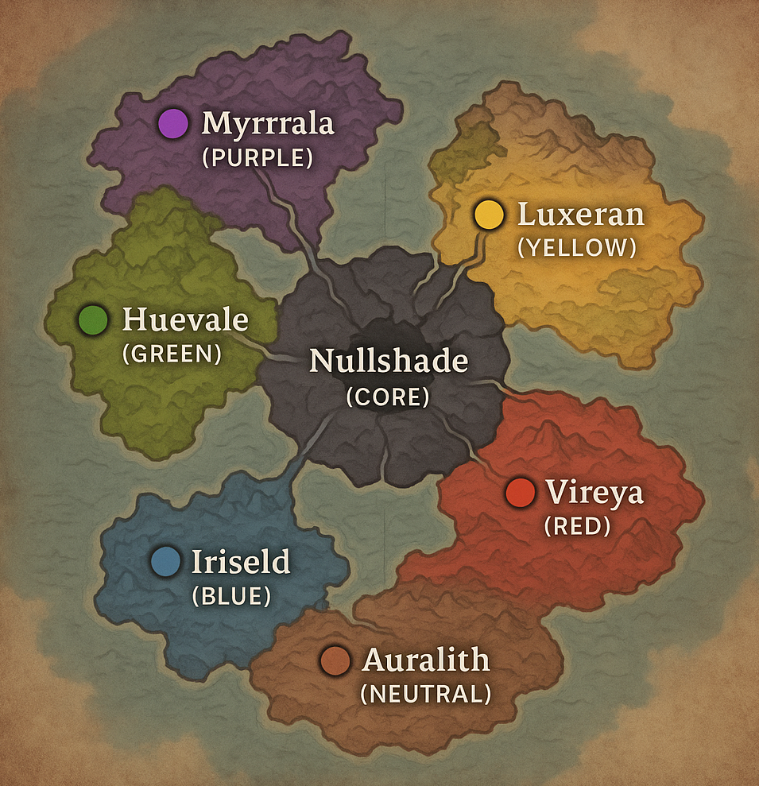
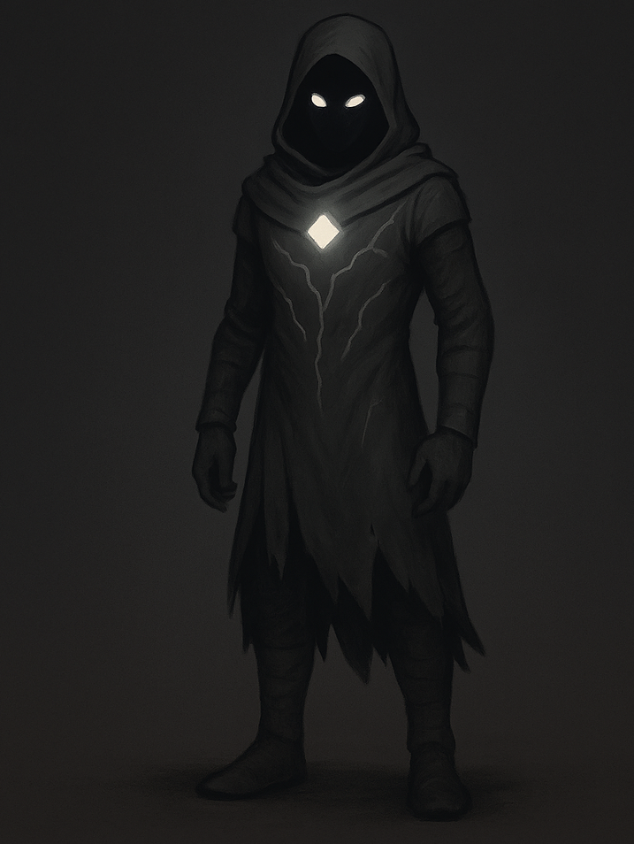
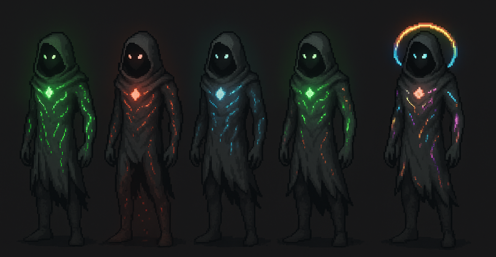

# 🎨 [The Realm]: A Color-Shattered World

Welcome to the design archive for [**The Realm**], 
a narrative-rich, hue-fractured fantasy world where emotion, memory, and magic are bound to color.

> ![NOTE]  
> [**The Realm**] is a placeholder name...

---

## 📘 Table of Contents

- [🎮 Game Design](#-game-design)
  - [🕹 Game Mechanics & Core System](#-game-mechanics--core-system)
  - [💎 Items – Catalogue](#-items--catalogue)
  - [📺 UI](#-ui)
- [🌍 World Overview](#-world-overview)
- [📜 Timeline & History](#-timeline--history)
- [🧬 Main Character – The Prismwalker](#-main-character--the-prismwalker)
- [🧠 Personality System](#-personality-system)
- [🌀 In-Game Visual Concepts](#-in-game-visual-concepts)
  - [📷 Example Scenes](#-example-scenes)
- [🪄 Myths & Omens](#-myths--omens)
- [🎭 NPC Characters](#-npc-characters)
- [👹 Enemies – Bestiary Index](#enemies--bestiary-index)
- [🎨 Color Codex](#-color-codex)
- [🗒️ Name Ideas](#name-ideas)
- [🌑 Endgame](#-endgame)
- [🗂️ File Structure & Visual Assets](#file-structure--visual-assets)
- [TODO List](#todo-list)

---

## 🎮 Game Design

Heavy-Lore color themed fantasy RPG Game project  
[See Game Desing Document - First Draft ►](./docs/gdd-draft.md)

### 🕹 Game Mechanics & Core System

- [See Game Mechanics Reference ►](./docs/core-systems.md)
- [See Hue-Binding System ►](./docs/gameplay/hue-binding.md)
- [See Hue-Affinity Tiers Logic ►](./docs/gameplay/hue-affinity.md)

### 💎 Items – Catalogue

Catalog of the major artifacts, relics, consumables, powers and tools, grouped by function.
- [Check Items – Catalogue ►](./docs/items.md)

### 📺 UI

- [Check Items – Catalogue ►](./docs/ui/ui.md)

---

## 🌍 World Overview

<div align="center">
  <h3>[The Realm]</h3>
  
  </br><i>“The Prism shattered. Now the hues rule alone...”</i></br>

  [**Read full world breakdown ►**](./docs/world.md)

</div>

<div align="center">

|                                                 |                                  |
| ----------------------------------------------- | -------------------------------- |
| 🟢 [**Huevale**](./docs/regions/huevale.md)     | Verdant growth & stealth puzzles |
| 🔴 [**Vireya**](./docs/regions/vireya.md)       | Ember-forged battlefield zone    |
| 🔵 [**Iriseld**](./docs/regions/iriseld.md)     | Floating sea-cliff archipelago   |
| 🟣 [**Myrrala**](./docs/regions/myrrala.md)     | Twilight glades of illusion      |
| 🟡 [**Luxeran**](./docs/regions/luxeran.md)     | Mirage-laced golden desert       |
| 🤎 [**Auralith**](./docs/regions/auralith.md)   | Rusted ruins & fossil memory     |
| ⚫ [**Nullshade**](./docs/regions/nullshade.md) | The broken, colorless core       |

</div>

---

## 📜 Timeline & History

> “All color was once one — until we tried to own it.”

[**See full timeline ►**](./docs/timeline.md)

- 🕊️ Age of Light — Unified Core  
- 🔮 Age of Echoes — Color Orders rise  
- ⚔️ Color War & Nullshade Plague  
- 💥 The Shattering — Realms fracture  
- 🌑 The Dimming Cycle — Your era begins  

---

## 🧬 Main Character – The Prismwalker

<div align="center">
  <h3>The Prismwalker</h3>
  
  </br><i>“Born without color. Bound to none. Shaped by every hue.”</i></br>

  [**Character breakdown ►**](./docs/main-character.md)

</div>

### Features:
- Customizable visual
- Dialogue influenced by color
- Combat system with Huebinding & Prismatic Burst

---

## 🧠 Personality System

> "Your hues don't just affect your skills — they shape your voice."

[**Click to see Full system ►**](./docs/personality-system.md)

### Mixed Personalities

[**Click to see Mixed personality breakdown ►**](./docs/personality-system-mixed.md)

<details>
<summary><strong>Click to see mixed personality examples:</strong></summary>

|                     |                        |
| ------------------- | ---------------------- |
| 🔴 Red + 🔵 Blue    | "The Calculated Flame" |
| 🟢 Green + 🤎 Brown | "The Earthbound"       |
| 🔴 + 🟣 + 🤎        | "The Ruined Crown"     |
</details>

---

## 🌀 In-Game Visual Concepts

<div align="center">
  <h3>Huebound Skin Concept</h3>
  

[**Click to see Character Visuals Document ►**](./docs/in-game-visuals.md)

</div>

### Features:
- Veins and aura based on hues
- Prism Core glow
- Clothing & trail effects by hue
- HUD integration suggestion

### 📷 Example Scenes

Some example in-game scene scripts for each regions

[**Click to see in-game scene examples ►**](./docs/scenes/scene-examples.md)  

---

## 🪄 Myths & Omens

> “The first color was silence.”  
> “When the sun weeps amber, even the blind must wear masks.”

[**Click to see More Prophecies & cryptic sayings ►**](./docs/myths-and-omens.md)

---

## 🎭 NPC Characters

[**Click to see important NPCs list ►**](./docs/NPCs/npcs-overview.md)

Includes:

- Character + Item ideas
- Usage in worldbuilding
- Dialogue

<details><summary>Click for an NPC entry example:</summary>

**Xanadu Warden**  
*Guardian of the Forgotten Gardens; poet-scout cloaked in ancient gray-green*  
**Item:** *Xanadu Stone* – Ancient mossy relic; grants visions of lost utopias when held in moonlight.
> "Gardens grow again, even over bones."\
> “This garden grew thorns when we fled.”\
> "If you listen, the moss remembers where you buried the truth."\
> “Hold the stone in moonlight — it’ll show you what we forgot.”  

**When leading the player into ancient ruins:**  
> “Roots grow around memory. Tread softly — some stones grieve.”
</details>

---

## 👹 Enemies - Bestiary Index <a id="enemies--bestiary-index"></a>

Bestiary for some creatures from each region, with lore and details.

Structure per Entry:
- Name: Evocative and thematic, often involving color or light-based terms.
- Flavor Quote: A short, poetic line — mysterious, lore-rich, often ironic.
- Visual Design: Concise description of physical appearance.
- Behavior: Specific, interesting mechanic that ties into the world/lore.
- Weakness/Counterplay: Each has at least one specific counter or condition.

[**Click to see Bestiary Index by Region ►**](./docs/enemies.md)

---

## 🎨 Color Codex

> [!IMPORTANT] This list is the origin of this whole thing..

[**Click to see complete color/style list ►**](./docs/colors.md)

Includes:

- ✅ Hex codes
- ✅ Color symbolism

<details>
<summary>Click to see a color entry example:</summary>

|   | Name | Hex | Description |
|---|------|-----|-------------|
|  | **Viridian** | `#40826D` | Bluish green; used in pigments and enchantment ink |
</details>

---

## 🗒️ Name Ideas <a id="name-ideas"></a>

List of color-themed names for the World, Regions, Factions, Kingdoms, etc.

[**Click to go to the Name Idea List](./docs/name-list.md)

---

## 🌑 Endgame
> [!WARNING] (SPOILER!!!)

[**Click to see what happens in the final moments (wip) ►](./docs/scenes/endgame.md)

---

## 🗂️ File Structure & Visual Assets <a id="file-structure--visual-assets"></a>

```
TODO
```

---

## TODO List <a id="todo-list"></a>

<details><summary>Click to reveal my todo list...</summary>

### Links

> - [Crystal shader to check](https://thegodotbarn.com/contributions/snippet/52/crystal-mesh-generator)  
> - ...

### 0. First
- [ ] Consolidate lore across docs
- [ ] Add clickable link back to bestiary for each enemy's doc page (fix image paths as well)

---

### 🧭 1. Faction & Culture Design (World Depth)
- Purpose: Populate the world with societies, customs, beliefs, and conflicts.
- Design 1–2 factions per region (e.g., Crimson Reclaimers in Vireya, Glasswright Guild in Iriseld)
- Establish belief systems, aesthetics, values, and rivalries
- Create color-based etiquette or taboos (e.g., in Luxeran, yellow is sacred and can’t be worn by outsiders)

---

### 🛡️ 2. Combat & Ability System (Gameplay Mechanics)
- Purpose: Define how the player interacts with the world mechanically.
- Develop the color-binding combat system (active/passive powers per hue)
- Create status effects tied to colors (e.g., green = regeneration, red = frenzy, purple = confusion)
- Establish weapon classes or magic schools tied to the color families

---

### 📜 3. Quests & Narrative Arcs (Story Structure)
- Purpose: Add personal, world-scale, and faction-based stories.
- Write main quest outline: Reforging the Prism, dealing with the Tyrian Purge
- Create side quests per region based on faction tensions, lost artifacts, or moral choices
- Add a few twist quests (e.g., NPC is colorless and hiding it)

---

### 🪶 4. Artifact & Item System
- Purpose: Deepen exploration and creativity.
- Finalize each color artifact (you already have great ones!) and add rare variants
- Define crafting/alchemy mechanics based on combining pigments or relics
- Create a color infusion system for gear

---

### 🏙️ 5. Key Locations, Dungeons, Shrines
- Purpose: Build the physical play space and memorable encounters.
- Flesh out major cities and hubs in each region
- Design a color-themed dungeon per biome (e.g., Verdant Labyrinth, Crimson Arena, Blooming Archive)
- Place shrines or Prism Gates that unlock traversal/powers

---

### 📖 6. NPC Roster & Dialogue Trees
- Purpose: Make the world feel alive and reactive.
- Create 1–2 major NPCs per region (e.g., a mentor, a rival, a betrayer)
- Add dialogue variations depending on color-bound status
- Write color-aligned greetings, insults, and lore drops

</details>

---

### Tools & Misc

- [markdown stuff i frequently use (wip)](./docs/assets/textual-tools.md)

---
