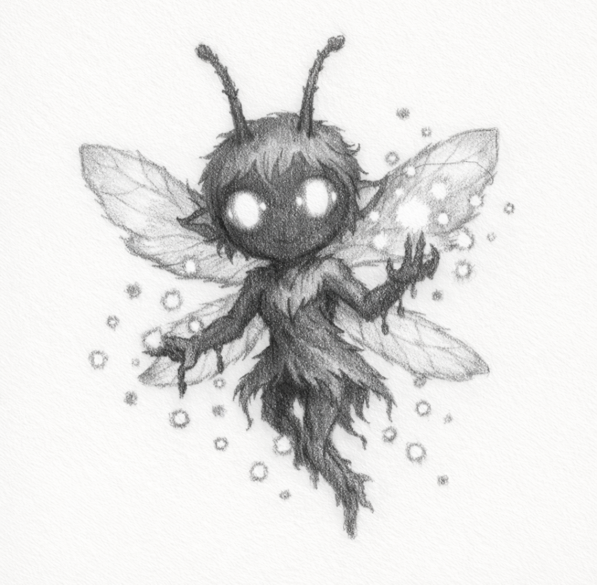
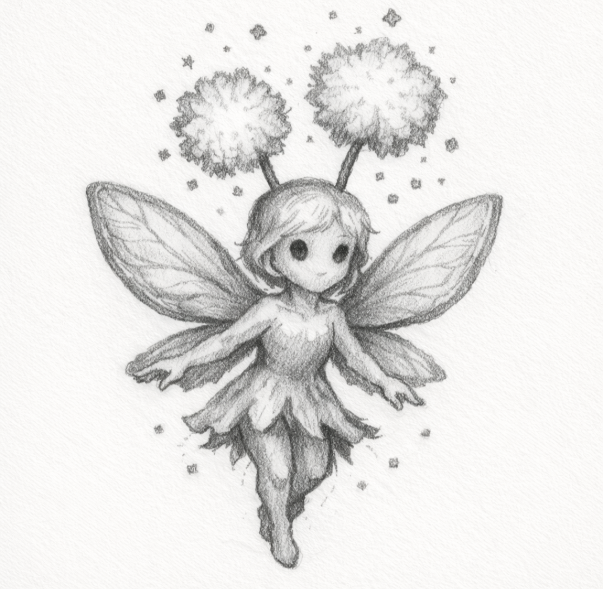

<!-- 🧚🧚‍♀️🧚‍♂️🧚🏾🧚🏿‍♀️🧚🏿 -->

  <h3>🧚 Chronopollen Sprite</h3>
  <i>It blooms a second too early. Or a century too late.</i> 
  
  
   <i>"Every sneeze moves the clock."</i>  

<!-- > Their pollen loosens the stitches between action and consequence. -->

Tiny, glowing time-fey born from flowers that bloomed before their own seeds.  
Scatter time-warping pollen that loosens the stitches between intention, action, and consequence.  
<!-- Slows or speeds up local time randomly for both player and enemies.   -->
Can be trapped in stasis meshes <!--(dreamcatcher-like artifacts)--> , 
anchored by root or echo magic, or exposed through truth-reflection.

<!--
### Chronopollen Sprite
**Role:** Temporal harrier  
**Tags:** `ILLUSIONIST`, `TRAPPER`  
**Visual:** Tiny fey mote trailing luminescent time-pollen  
**Behavior:** Causes local time hiccups, delayed inputs, or trap windows.  
**Counterplay:** Stasis capture, quick burst clear, or pattern isolation before other enemies join.  
**Notes:** Useful support enemy in mixed glamour fights.
-->

<!--
The Chronopollen Sprite should not feel like a generic mischievous fairy. 

It should feel like a small, accidental symptom of Myrrala’s broken sequence logic: 
a fey born where flowers, memories, and seconds bloom in the wrong order. 

Its danger is not damage; it makes timing, cause, and intention unreliable. 

It belongs near Liseran Shrine, Veilgrove Spiral, mirrored garden rooms, 
or any place where dream-pollen has been exposed to Nullshade leakage or overused Violet glamour.
-->

---

## Lore Entry

See Chronopollen Sprite Lore Entry

Lore Entry: From the Pollen-Caught Notes of the Bloomfold Archivist

> "I blinked, and the flower had already wilted. I blinked again, and it was only a seed."

> The Chronopollen Sprites are not cruel. Cruelty requires sequence:  
> First the want, then the act, then the wound.  
> These little things have never understood that order.

> They hatch where Myrrala forgets which moment it is wearing 
> — beneath clockblossoms, inside abandoned spring rites, 
> and around lilies that bloom before anyone remembers planting them.

> After the Huefall, many believed the Blooming Veil had merely become strange. 
> That was kinder than the truth. 
> The Core did not break only land and color. 
> It broke the agreement between one moment and the next.

> I found the same warning etched into a gray shard near the old bloompath: 
> "To fracture the Prism is to unravel time." 
> The Sprites gathered around the words as if they were sugar.
> 
> Their pollen does not age you. Not exactly. 
> It slips between intention and consequence. 
> A hand reaches. A door opens yesterday. 
> A blade misses because the wound has not decided whether it happened.

> I watched one settle on a dead lily. 
> The lily bloomed backward. Then it apologized to the seed.

> Do not inhale near them. Do not chase them. 
> And if one giggles before you hear it arrive, leave immediately.

> — Bloomfold Archivist, 
> recovered from a journal whose pages were written out of order

---

## Bestiary Entry
Name: Chronopollen Sprite  
Type: Temporal Fey / Pollen-Warp Trickster  
Threat Level: ⚠️ Moderate — Timing Disruption and Sequence Instability  
First Emerged: Post-Huefall, 
along the time-softened bloompaths of Veilgrove Spiral 
and the outer gardens of Liseran Shrine 

<!-- During the Bloomwake Season, 
when the Veilgrove lilies began blooming out of order   -->

### Description:
Chronopollen Sprites are small Myrralan fey 
made of petal-light, violet-blue wing shimmer, 
and drifting pollen motes that pulse like faulty clockticks.  
Their bodies seem delicate, but their presence makes the local order of events unreliable.

They rarely attack with intent. 
They scatter, sneeze, panic, and laugh in the wrong order.
<!-- Wherever their pollen lands, time briefly forgets its direction.  -->

Their pollen loosens local time. 
A battlefield touched by Chronopollen becomes unreliable: 
enemies may lunge too slowly, projectiles may arrive before they are fired, 
and the Prismwalker may dodge into the echo of a movement they have not made yet.
<!-- and the player may dodge into a movement they made seconds ago. -->

The Sprite is not a master of time. 
It is a symptom of Myrrala’s broken sequence logic 
— a living accident born where dream pollen, glamour residue, 
and soft Nullshade leakage have made cause and effect negotiable.  
<!-- They are a minor symptom of the Shattering rather than an intentional species.  
Where Violet glamour, dream pollen, 
and soft Nullshade intrusion overlap, flowers may bloom in the wrong season, 
then shed pollen from futures they never reached.  
If enough of that pollen gathers, a Sprite hatches laughing. -->

Repeated exposure can desynchronize Mneme use, 
causing an active hue ability to resolve late or flicker into a false start.  
Chronopollen does not usually drain Mneme directly, 
but it can make the Prismwalker spend it at the wrong moment.

### Hue Interaction:
- **Cobalt / Mind Echo:** Reveals the Sprite’s next time-slip and briefly marks where delayed actions will resolve. Cobalt stabilizes sequence without rewriting it.
- **Violet / Illusion Clone:** Draws pollen toward the false target, causing the Sprite to pollinate the clone instead of the Prismwalker.
- **Violet / Glamour Pulse:** Can reverse a pollen cloud’s drift, but may duplicate the cloud if cast during a time-stutter.
- **Aurelian / Radiant Flash:** Burns away loose pollen motes and reveals safe movement lanes. Overbright light may startle the Sprite into a wider Chronosneeze.
- **Verdant / Root Bind or Skygrowth Seed:** Anchors a small area, preventing acceleration, slowdown, or brief reversal inside the rooted radius.
- **Earthen / Earthen Echo:** Restores timing to Mneme flow and clears minor sequence-glitches caused by repeated exposure.
- **Thulian Mirror:** Reveals the Sprite’s “true second” — the one moment when it is synchronized with ordinary time and can be struck cleanly.
- **Razzmatazz Drum:** Forces its wingbeats back into tempo, grounding it briefly if played on the skipped beat.

<!--
For counterplay, it should connect to the main systems this way: 
Cobalt detects the true sequence, 
Violet redirects or confuses its glamour behavior, 
Aurelian burns pollen away but risks scattering it, 
Verdant/Earthen can anchor local time, 
and the Thulian Mirror reveals the Sprite’s “true second” 
because the Mirror shows truth without showing the whole picture.
-->

- Cobalt’s Mind Echo reveals the Sprite’s next time-slip 
  and briefly marks where delayed actions will resolve.
- Violet’s Illusion Clone can draw pollen away from the Prismwalker, 
  causing the Sprite to pollinate the false target instead.
- Violet Glamour Pulse can reverse a pollen cloud’s direction, 
  but may also duplicate the cloud if mistimed.
- Aurelian Radiant Flash burns away loose pollen motes, 
  though overbright light may startle the Sprite into scattering faster.
- Verdant root effects can anchor a small area, 
  preventing acceleration, slowdown, or brief reversal inside the radius.
- Earthen Echo stabilizes Memory Stability glitches 
  caused by repeated Chronopollen exposure.
- Thulian Mirror reveals the Sprite’s “true second” 
  — the one moment when it is synchronized with ordinary time and can be struck cleanly.

### Behavior:
<!-- - Flutters erratically above bloompaths, shrine gardens, mirrored ponds, 
  and pollen-heavy combat spaces.
- Releases drifting pollen clouds that randomly slow, 
  hasten, or briefly reverse local movement.
- Can accidentally speed up nearby enemies, 
  making simple encounters suddenly dangerous.
- Uses Chronosneeze when startled, desynchronizing projectiles, dodge timing, 
  and enemy windups in a small radius.
- Occasionally pauses midair and glows brighter; 
  this signals that it is about to skip to a nearby future position.
- If ignored, may trail the player for several rooms, 
  causing minor cooldown flickers and false movement echoes. -->
- Flutters erratically above bloompaths, shrine gardens, mirrored ponds, 
- and pollen-heavy combat spaces.
- Releases drifting pollen clouds that randomly slow, 
- hasten, or briefly reverse local movement.
- Accidentally speeds up nearby enemies, 
  making simple encounters dangerous when paired with duelists, 
  imps, or mirror creatures.
- Uses **Chronosneeze** when startled, desynchronizing projectiles, 
  dodge timing, enemy windups, and short-lived terrain hazards in a small radius.
- Pauses midair and glows brighter before skipping to a nearby future position.
- Becomes agitated near Nullshade exposure: 
  its pollen loses color at the edges, 
  and its time-warp fields become harsher and less playful.
- Circles the Prismwalker’s shard if Violet or Cobalt is currently bound, 
  as if trying to decide whether the player is a flower, a mirror, or a clock.

### Known Weaknesses:
<!-- - Vulnerable during its post-sneeze daze, 
  when its wings stop beating for one true second.
- Can be trapped in dreamcatcher-like artifacts 
  while passing through its own pollen cloud.
- Stasis loops freeze both the Sprite and its pollen, 
  allowing the player to safely clear or redirect the hazard.
- Verdant or Earthen anchoring magic reduces the radius and duration of its time-warp field.
- The Thulian Mirror exposes its synchronized position, 
  bypassing false afterimages and delayed hitboxes.
- Rhythmic tools such as the Razzmatazz Drum 
  can force its wingbeats back into normal tempo. -->

- Vulnerable during its post-sneeze daze, 
  when its wings stop beating for one true second.
- Cobalt Mind Echo exposes delayed hitboxes 
  and prevents false afterimages from drawing attacks.
- Verdant and Earthen anchoring magic reduce the radius 
  and duration of its time-warp field.
- The Thulian Mirror exposes its synchronized position, 
  bypassing skipped frames and false futures.
- Stasis loops freeze both the Sprite and its pollen, 
  allowing the player to safely clear or redirect the hazard.
- Rhythmic tools such as the Razzmatazz Drum can ground the Sprite 
  if the player strikes on the recovered beat.
- Prism Glyph Anchors or similar stabilizing relics 
  can pin a pollen cloud in place long enough to harvest it safely.

### Notes:

Chronopollen residue is prized by reckless alchemists, clockmakers, dream archivists
and anyone foolish enough to believe regret can be fixed by rewinding it.

Some travelers report meeting the same Sprite multiple times 
in different eras of the same room. 
Others claim that defeating one causes a flower nearby to bloom before it is planted.

High Violet affinity may cause Sprites to become curious rather than hostile.  
High Cobalt affinity makes their patterns easier to read.  
Heavy Nullshade exposure makes them unstable, 
causing their pollen to desaturate and trigger harsher sequence breaks.

A common Bloomfold warning reads:  
> "Where time forgets to move, step backward into now. 
> If the pollen follows, you were never first."

Scholars disagree on whether Chronopollen Sprites 
travel through time, damage time, or simply fail to notice it.

---
