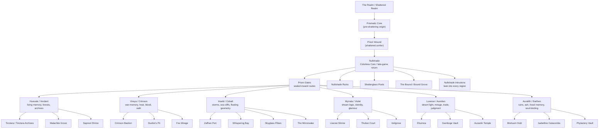

I found the main geography material in `WORLD_DOCS`, especially `overview.md`, the `regions/` folder, `OVERHAUL.md`, and the Nullshade revision files. I’m treating `nullshade-v2.md` as the cleanest canon because it explicitly resolves the “origin vs late-game zone” contradiction. 

## Geographic structure graph

## Spatial read of the world

The Realm is built as seven major zones: six outer chromatic regions around a central colorless wound. Your overview places Nullshade at the center, with Myrrala above, Huevale and Luxeran on the upper-left/right, Iriseld and Vireya lower-left/right, and Auralith below. 

The strongest world model is: “six hue-aligned outer regions + Nullshade at the center.” `OVERHAUL.md` defines this as a shattered realm organized around the Prismatic Core’s crater, with each region having its own city, hazards, traversal logic, artifact hooks, and a Prism Gate relationship to the Core. 

## Region-by-region location tree

| Region        | Main city / hub | Confirmed key locations                                                          | Other named or implied locations                                                                                                                                     |
| ------------- | --------------- | -------------------------------------------------------------------------------- | -------------------------------------------------------------------------------------------------------------------------------------------------------------------- |
| **Nullshade** | Prism Wound     | Nullshade Ruins, Shatterglass Pools, Collapsed Monoliths, The Bound, Prism Wound | Memory Gate Circles, Bound Grove, Nullshade intrusions, possible Noctalon                                                                                            |
| **Huevale**   | Tinctara        | Tinctara Archives, Malachite Grove, Saproot Shrine                               | Sporeveil Hollow, Verdant Spiral, Mycelial Sanctum, Verdelune, Boscara, Thalloroot, Mosschant, Virdatha, Chartrevia, Sapreach, Viridia, The Overglen, Emerald Hollow |
| **Vireya**    | Crimson Bastion | Duelist’s Pit, Fox Mirage                                                        | Scoria’s Throne, Crucible Spires, Emberglass Forge, Trial Pits, Ashglint, Crimsonhale, Flinthymn, Serrakar, Emberfall, Cinnaridge, Amaroth Vale, Fauxflame Crags     |
| **Iriseld**   | Zaffran Port    | Whispering Bay, Skyglass Pillars, The Mirrorwake                                 | Tidemirror Reach, Shipwake Cross, Glassmoor Caverns, Moonwake Docks, Glasvale, Stormirth                                                                             |
| **Myrrala**   | Liseran Shrine  | Thulian Court, Veilgrove                                                         | Dreamroot Loom, Thulian Gate, Blooming Mirror, Woven Memory Steps, Thulian Grove, Heliobloom, Liseran Hollow, The Petal Labyrinth                                    |
| **Luxeran**   | Eburnea         | Gamboge Vault, Aureolin Temple                                                   | Gilded Hollow, Sundial Temple, Citrine Corridor, Glass Mirage Vaults, Gildora, Aurenza                                                                               |
| **Auralith**  | Mortuum Hold    | Isabelline Catacombs, Phylactery Vault                                           | Rustclad Archive, Golm Burial Fields, Dustmere                                                                                                                       |

The core confirmed city/key-location sets come from the region files and overview. Huevale has Tinctara, Malachite Grove, and Saproot Shrine; Vireya has Crimson Bastion, Duelist’s Pit, and Fox Mirage; Iriseld has Zaffran Port, Whispering Bay, Skyglass Pillars, and The Mirrorwake; Myrrala has Liseran Shrine, Thulian Court, and Veilgrove; Luxeran has Eburnea, Gamboge Vault, and Aureolin Temple; Auralith has Mortuum Hold, Isabelline Catacombs, and Phylactery Vault. 

The “other named locations” mainly come from `OVERHAUL.md` search snippets, so I would mark those as **candidate / backlog locations** unless you decide they are canonical. 

## Functional map logic

Each region should not just look different; it should behave according to a local metaphysical rule.

Huevale: vegetation regrows and reacts.  
Vireya: heat, blood, and battle awaken dormant forces.  
Iriseld: wind and gravity alter access; memory rides weather.  
Myrrala: the player’s loadout changes the landscape.  
Luxeran: mirages falsify the map.  
Auralith: player actions leave ghosts behind.  
Nullshade: truth is spatially and mnemonically sealed. 

This gives you a clean design rule for every area: each region gets one city, two to four surrounding landmarks, one route to a Prism Gate, and one environmental law that changes traversal.

## Recommended world plan

Use **Nullshade** as the hidden center, not as a normal hub. It is both a sealed place and a leaking phenomenon: the true region is late-game, while smaller Nullshade intrusions can appear early in every outer region. 

Use each outer region as a spoke in the world wheel. Every spoke should lead inward through a Prism Gate, but the way to reach that gate should reflect the region’s rule. Huevale’s route should be grown or remembered open; Vireya’s should be earned through conflict/oath; Iriseld’s through wind, sound, and vertical traversal; Myrrala’s through identity/illusion; Luxeran’s through true-vs-false pathing; Auralith’s through memory, ruin, and death residue.

Keep **Iriseld** and **Myrrala** distinct even though both involve illusion. Your notes define Blue/Cobalt as perception, clarity, memory, sound, and storm logic, while Purple/Violet handles identity, falsehood, glamour, and dream logic. 

The result is a strong usable map model:

**Outer world = six color philosophies.**  
**Inner world = the colorless contradiction they are all avoiding.**  
**Progression = learning enough regional laws to survive the place where all laws collapse.**
