# High-Quality Mermaid Graph — World / Geography / NPC / Enemy Integration

Below is an integrated mermaid graph that links the world structure, regional geography, NPCs, enemies, and the Nullshade intrusion layer.

```mermaid
flowchart TB

%% =========================
%% STYLES
%% =========================
classDef core fill:#ede9fe,stroke:#7c3aed,stroke-width:2px,color:#111827;
classDef region fill:#dbeafe,stroke:#2563eb,stroke-width:2px,color:#111827;
classDef location fill:#fef3c7,stroke:#d97706,stroke-width:1.5px,color:#111827;
classDef npc fill:#dcfce7,stroke:#16a34a,stroke-width:1.5px,color:#111827;
classDef enemy fill:#fee2e2,stroke:#dc2626,stroke-width:1.5px,color:#111827;
classDef concept fill:#e5e7eb,stroke:#6b7280,stroke-width:1.5px,color:#111827;
classDef gate fill:#cffafe,stroke:#0891b2,stroke-width:1.5px,color:#111827;

%% =========================
%% GLOBAL STRUCTURE
%% =========================
Realm["The Realm / Shattered Realm"]:::core
Core["Prismatic Core<br/>pre-shattering origin"]:::core
Wound["Prism Wound<br/>shattered center"]:::core
Nullshade["Nullshade<br/>Colorless Core / late-game return"]:::core
Leaks["Nullshade Intrusions / Exposure<br/>leaks into all outer regions"]:::concept

Realm --> Core --> Wound --> Nullshade
Nullshade -.-> Leaks

Gate_H["Huevale Prism Gate"]:::gate
Gate_V["Vireya Prism Gate"]:::gate
Gate_I["Iriseld Prism Gate"]:::gate
Gate_M["Myrrala Prism Gate"]:::gate
Gate_L["Luxeran Prism Gate"]:::gate
Gate_A["Auralith Prism Gate"]:::gate

Nullshade --> Gate_H
Nullshade --> Gate_V
Nullshade --> Gate_I
Nullshade --> Gate_M
Nullshade --> Gate_L
Nullshade --> Gate_A

%% =========================
%% HUEVALE
%% =========================
subgraph SG_H["Huevale — The Verdant Frontier"]
direction TB
H["Huevale<br/>living memory / adaptive growth"]:::region
H_Hub["Tinctara / Tinctara Archives"]:::location
H_L1["Malachite Grove"]:::location
H_L2["Saproot Shrine"]:::location
H_L3["Verdant Spiral / Sporeveil Hollow / Mycelial Sanctum"]:::location

H_NPC1["Celadon Archivist"]:::npc
H_NPC2["Viridian Alchemist"]:::npc
H_NPC3["Malachite Oracle"]:::npc
H_NPC4["Xanadu Warden"]:::npc
H_NPC5["Limerick Druid"]:::npc
H_NPC6["Skobeloff Diver"]:::npc
H_NPC7["Smaragdine Knight"]:::npc
H_NPC8["Chartreuse Initiate"]:::npc
H_NPC9["Feldgrau Veteran"]:::npc
H_NPC10["Harlequin Trickblade"]:::npc
H_NPC11["Saproot Cultist"]:::npc
H_NPC12["Thalera the Rootborn"]:::npc

H_E1["Sapborn Stalker"]:::enemy
H_E2["Boglight Mimic"]:::enemy
H_E3["Verdant Maw"]:::enemy
H_E4["Sporekin"]:::enemy
H_E5["Thornwrithe Beast"]:::enemy
H_E6["Limeroot Trickster"]:::enemy
H_E7["Chartreuse Husk"]:::enemy
H_E8["Grovebound Sentinel"]:::enemy
H_E9["Fangbloom Wyrm"]:::enemy
H_E10["Mossgrave Revenant"]:::enemy
H_E11["Moth-Witch of the Verdant Spiral"]:::enemy
H_E12["Hue Leeches"]:::enemy

H --> H_Hub
H --> H_L1
H --> H_L2
H --> H_L3
H --> Gate_H

H_Hub --> H_NPC1
H_Hub --> H_NPC2
H_Hub --> H_NPC6
H_Hub --> H_NPC8
H_Hub --> H_NPC9

H_L1 --> H_NPC3
H_L1 --> H_NPC7

H_L2 --> H_NPC11
H_L2 --> H_NPC12

H_L3 --> H_NPC4
H_L3 --> H_NPC5
H_L3 --> H_NPC10

H_L3 --> H_E1
H_L3 --> H_E2
H_L3 --> H_E4
H_L3 --> H_E5
H_L3 --> H_E6
H_L3 --> H_E7
H_L3 --> H_E12

H_L1 --> H_E3
H_L1 --> H_E9
H_L1 --> H_E11

H_Hub --> H_E8
H_L2 --> H_E10
end

%% =========================
%% VIREYA
%% =========================
subgraph SG_V["Vireya — The Ember Expanse"]
direction TB
V["Vireya<br/>war-memory / heat / oath / blood"]:::region
V_Hub["Crimson Bastion"]:::location
V_L1["Duelist's Pit"]:::location
V_L2["Fox Mirage"]:::location
V_L3["Scoria's Throne / Crucible Spires / Emberglass Forge"]:::location
V_L4["Banner Roads / Amaroth Vale / Trial Pits"]:::location

V_NPC1["Vermilion Duelist"]:::npc
V_NPC2["Amaranth the Undying"]:::npc
V_NPC3["Alizarin the Crimson Weaver"]:::npc
V_NPC4["Nacarat the Fox"]:::npc
V_NPC5["Falu Homesteader"]:::npc
V_NPC6["Coquelicot Banner"]:::npc
V_NPC7["Cinnabar Mask"]:::npc
V_NPC8["Sanguine Quartermaster"]:::npc
V_NPC9["Rustbanner Child"]:::npc

V_E1["Ashwrought Colossus"]:::enemy
V_E2["Crimson Echo"]:::enemy
V_E3["Lava-Fused Behemot"]:::enemy
V_E4["Glasslash Serpent"]:::enemy
V_E5["Bannerbound Revenant"]:::enemy
V_E6["Searblood Cultist"]:::enemy
V_E7["Funeral Dancer"]:::enemy
V_E8["Bloodroot Effigy"]:::enemy
V_E9["Red Widow"]:::enemy
V_E10["Wickerborn"]:::enemy
V_E11["Tyrian Echo"]:::enemy
V_E12["Rustworn Judge"]:::enemy

V --> V_Hub
V --> V_L1
V --> V_L2
V --> V_L3
V --> V_L4
V --> Gate_V

V_Hub --> V_NPC3
V_Hub --> V_NPC7
V_Hub --> V_NPC8
V_Hub --> V_NPC9

V_L1 --> V_NPC1
V_L2 --> V_NPC4
V_L4 --> V_NPC2
V_L4 --> V_NPC5
V_L4 --> V_NPC6

V_L3 --> V_E1
V_L3 --> V_E3
V_L3 --> V_E4

V_L1 --> V_E2
V_L1 --> V_E7

V_L4 --> V_E5
V_L4 --> V_E8
V_L4 --> V_E9
V_L4 --> V_E10
V_L4 --> V_E11
V_Hub --> V_E6
V_Hub --> V_E12
end

%% =========================
%% IRISELD
%% =========================
subgraph SG_I["Iriseld — The Tidespire Reach"]
direction TB
I["Iriseld<br/>storm-memory / sound / reflection"]:::region
I_Hub["Zaffran Port"]:::location
I_L1["Whispering Bay"]:::location
I_L2["Skyglass Pillars"]:::location
I_L3["The Mirrorwake"]:::location
I_L4["Tidemirror Reach / Glassmoor Caverns / Floating Cliffs"]:::location

I_NPC1["Zaffre Glasswright"]:::npc
I_NPC2["Cerulean Skydancer"]:::npc
I_NPC3["Glaucous Wing"]:::npc
I_NPC4["Payne's Shade"]:::npc
I_NPC5["Eigengrau the Unseeing"]:::npc

I_E1["Glassborne Echo"]:::enemy
I_E2["Skycall Wraith"]:::enemy
I_E3["Stormwrit Hound"]:::enemy
I_E4["Tideworn Apostle"]:::enemy
I_E5["Mirrorwake Duelist"]:::enemy
I_E6["Feathered Null"]:::enemy
I_E7["Abyssal Current"]:::enemy
I_E8["Tempest Marionette"]:::enemy
I_E9["Sorrowwing"]:::enemy

I --> I_Hub
I --> I_L1
I --> I_L2
I --> I_L3
I --> I_L4
I --> Gate_I

I_Hub --> I_NPC1
I_L2 --> I_NPC2
I_L4 --> I_NPC3
I_L3 --> I_NPC4
I_L4 --> I_NPC5

I_L2 --> I_E1
I_L4 --> I_E2
I_L4 --> I_E3
I_L1 --> I_E4
I_L3 --> I_E5
I_L4 --> I_E6
I_L1 --> I_E7
I_L2 --> I_E8
I_L4 --> I_E9
end

%% =========================
%% MYRRALA
%% =========================
subgraph SG_M["Myrrala — The Blooming Veil"]
direction TB
M["Myrrala<br/>identity distortion / glamour / dream logic"]:::region
M_Hub["Liseran Shrine"]:::location
M_L1["Thulian Court"]:::location
M_L2["Veilgrove"]:::location
M_L3["Dreamroot Loom / Blooming Mirror / Time-Bent Corridors"]:::location
M_L4["Thulian Gate / Heliobloom / Petal Labyrinth"]:::location

M_NPC1["Liseran Caretaker"]:::npc
M_NPC2["Thulian Emissary"]:::npc
M_NPC3["Fandango Duelstar"]:::npc
M_NPC4["Razzmatazz Sprite"]:::npc
M_NPC5["Periwinkle Siren"]:::npc
M_NPC6["Quinacridone Blade"]:::npc
M_NPC7["Heliotrope Devotee"]:::npc
M_NPC8["Wisteria Enchantress"]:::npc
M_NPC9["Mauveine Spark"]:::npc
M_NPC10["Pomp & Power Chancellor"]:::npc

M_E1["Doppelshade"]:::enemy
M_E2["Lilyborn Mirage"]:::enemy
M_E3["Bloomveil Widow"]:::enemy
M_E4["Glittering Grimoire"]:::enemy
M_E5["Chronopollen Sprite"]:::enemy
M_E6["Fandancer Fragment"]:::enemy
M_E7["Veilshift Matron"]:::enemy
M_E8["Thulian Vowkeep"]:::enemy
M_E9["Razzflare Imp"]:::enemy

M --> M_Hub
M --> M_L1
M --> M_L2
M --> M_L3
M --> M_L4
M --> Gate_M

M_Hub --> M_NPC1
M_Hub --> M_NPC5
M_L1 --> M_NPC2
M_L1 --> M_NPC3
M_L1 --> M_NPC10
M_L2 --> M_NPC8
M_L3 --> M_NPC4
M_L3 --> M_NPC6
M_L3 --> M_NPC9
M_L4 --> M_NPC7

M_L1 --> M_E1
M_Hub --> M_E2
M_L2 --> M_E3
M_L3 --> M_E4
M_L4 --> M_E5
M_L1 --> M_E6
M_L2 --> M_E7
M_L4 --> M_E8
M_L3 --> M_E9
end

%% =========================
%% LUXERAN
%% =========================
subgraph SG_L["Luxeran — The Gilded Expanse"]
direction TB
L["Luxeran<br/>radiance / mirage / legitimacy / judgment"]:::region
L_Hub["Eburnea"]:::location
L_L1["Gamboge Vault"]:::location
L_L2["Aureolin Temple"]:::location
L_L3["Citrine Corridor / Glass Mirage Vaults"]:::location
L_L4["Gilded Hollow / Sundial Temple / Dune Roads"]:::location

L_NPC1["Eburnean Priestess"]:::npc
L_NPC2["Citrine Artisan"]:::npc
L_NPC3["Gamboge Monk"]:::npc
L_NPC4["Fulvous Hunter"]:::npc
L_NPC5["Orangepeel Courier"]:::npc
L_NPC6["Aureolin Flame"]:::npc

L_E1["Sunburnt Jackal"]:::enemy
L_E2["Mirage Revenant"]:::enemy
L_E3["Cinnabar Scarab"]:::enemy
L_E4["Ambercoil Asp"]:::enemy
L_E5["Gamboge Djinnling"]:::enemy
L_E6["Hollow Prophet"]:::enemy
L_E7["Citrine Golem"]:::enemy
L_E8["Sunflare Marionette"]:::enemy
L_E9["Heliotropic Lurker"]:::enemy

L --> L_Hub
L --> L_L1
L --> L_L2
L --> L_L3
L --> L_L4
L --> Gate_L

L_Hub --> L_NPC1
L_Hub --> L_NPC2
L_Hub --> L_NPC5
L_L1 --> L_NPC3
L_L4 --> L_NPC4
L_L2 --> L_NPC6

L_L4 --> L_E1
L_L3 --> L_E2
L_L3 --> L_E3
L_L4 --> L_E4
L_L1 --> L_E5
L_L2 --> L_E6
L_L3 --> L_E7
L_L4 --> L_E8
L_L4 --> L_E9
end

%% =========================
%% AURALITH
%% =========================
subgraph SG_A["Auralith — The Dimming Hollow"]
direction TB
A["Auralith<br/>residue / ruin / soul-binding / fossil memory"]:::region
A_Hub["Mortuum Hold"]:::location
A_L1["Isabelline Catacombs"]:::location
A_L2["Phylactery Vault"]:::location
A_L3["Rustclad Archive / Golm Burial Fields / Dustmere"]:::location

A_NPC1["Caput Mortuum Ascetic"]:::npc
A_NPC2["Bistre Archivist"]:::npc
A_NPC3["Isabelline Widow"]:::npc
A_NPC4["Burnt Sienna Sculptor"]:::npc
A_NPC5["Mikado Warlord"]:::npc

A_E1["Memory Husk"]:::enemy
A_E2["Sootshade Collector"]:::enemy
A_E3["Alchemical Echo"]:::enemy
A_E4["Wickborn Lantern"]:::enemy
A_E5["Ochre Golem"]:::enemy
A_E6["Caput Marionette"]:::enemy
A_E7["Rustworn Judge"]:::enemy
A_E8["Tapestry Watcher"]:::enemy

A --> A_Hub
A --> A_L1
A --> A_L2
A --> A_L3
A --> Gate_A

A_Hub --> A_NPC1
A_L3 --> A_NPC2
A_L1 --> A_NPC3
A_L3 --> A_NPC4
A_Hub --> A_NPC5

A_L3 --> A_E1
A_L3 --> A_E2
A_L3 --> A_E3
A_L1 --> A_E4
A_L3 --> A_E5
A_L2 --> A_E6
A_Hub --> A_E7
A_L3 --> A_E8
end

%% =========================
%% NULLSHADE
%% =========================
subgraph SG_N["Nullshade — The Colorless Core / Prism Wound"]
direction TB
N["Nullshade<br/>anti-coherence / contradiction / memory collapse"]:::region
N_Hub["Prism Wound"]:::location
N_L1["Nullshade Ruins"]:::location
N_L2["Shatterglass Pools"]:::location
N_L3["Collapsed Monoliths / Broken Geometry"]:::location
N_L4["The Bound / Bound Grove / Memory Gate Circles"]:::location

N_E1["Prism Unform"]:::enemy
N_E2["The Bound"]:::enemy
N_E3["Nullshade Echo"]:::enemy
N_E4["Null-Root"]:::enemy
N_E5["Silence Incarnate"]:::enemy
N_E6["Fractal Shardling"]:::enemy
N_E7["Wound Remnant"]:::enemy
N_E8["Nullshade Revenant"]:::enemy
N_E9["The Unhued Choir"]:::enemy
N_E10["The Seventh Hue"]:::enemy
N_E11["The Colorless Shape"]:::enemy
N_E12["Memory Leech"]:::enemy
N_E13["Tapestry Watcher — Nullshade Variant"]:::enemy
N_E14["Spectral Harvester"]:::enemy
N_E15["Memory Grafter"]:::enemy

N --> N_Hub
N --> N_L1
N --> N_L2
N --> N_L3
N --> N_L4

N_Hub --> N_E1
N_Hub --> N_E7
N_Hub --> N_E10
N_Hub --> N_E11
N_Hub --> N_E15

N_L1 --> N_E8
N_L1 --> N_E14
N_L2 --> N_E3
N_L2 --> N_E9
N_L3 --> N_E4
N_L3 --> N_E5
N_L3 --> N_E6
N_L4 --> N_E2
N_L4 --> N_E12
N_L4 --> N_E13
end

%% =========================
%% INTRUSION / CROSS-REGION LINKS
%% =========================
Leaks -.-> H
Leaks -.-> V
Leaks -.-> I
Leaks -.-> M
Leaks -.-> L
Leaks -.-> A

N_E12 -. "drains stability" .-> H_E12
N_E12 -. "appears in memory-heavy zones" .-> A_E1
N_E10 -. "secret contradiction thread" .-> A_E8
N_E13 -. "archive-break variant" .-> A_E8
V_E11 -. "mixed-hue war echo" .-> Nullshade
I_E6 -. "Nullshade-tainted aerial form" .-> Nullshade

%% =========================
%% REGION TO GATE RELATION
%% =========================
H --> Gate_H
V --> Gate_V
I --> Gate_I
M --> Gate_M
L --> Gate_L
A --> Gate_A

Gate_H --> Nullshade
Gate_V --> Nullshade
Gate_I --> Nullshade
Gate_M --> Nullshade
Gate_L --> Nullshade
Gate_A --> Nullshade
```

