# NPC and Enemy Geography Organization

This file organizes NPCs and enemies in relation to the game’s geographic structure.

Source basis: the NPC split files, `npc-full-list.md`, region docs, `OVERHAUL.md`, `complete_bestiary_draft.md`, and bestiary analysis files. The enemy organization uses a confidence label because the bestiary is more systemic than geographic: some enemies are explicitly tied to regions, while others are inferred from naming, ecology, or region-law logic.

## Confidence labels

- **Confirmed**: Directly listed under a region, region file, split NPC folder, or region-specific enemy search result.
- **Strong fit**: Not always explicitly tied to a landmark, but strongly implied by region law, enemy theme, or naming.
- **Candidate / backlog**: Named in notes or concept lists, but not yet clearly locked to a final geographic slot.

---

# High-level relationship graph

```mermaid
graph TD
  Realm["The Realm / Shattered Realm"]

  Realm --> Nullshade
  Realm --> Huevale
  Realm --> Vireya
  Realm --> Iriseld
  Realm --> Myrrala
  Realm --> Luxeran
  Realm --> Auralith

  Nullshade["Nullshade / Prism Wound"]
  Huevale["Huevale / Verdant Frontier"]
  Vireya["Vireya / Ember Expanse"]
  Iriseld["Iriseld / Tidespire Reach"]
  Myrrala["Myrrala / Blooming Veil"]
  Luxeran["Luxeran / Gilded Expanse"]
  Auralith["Auralith / Dimming Hollow"]

  Huevale --> H_NPC["Huevale NPCs: wardens, archivists, druids, alchemists, relic divers"]
  Huevale --> H_ENEMY["Huevale enemies: plant ambushers, pollen disruptors, living archive predators"]

  Vireya --> V_NPC["Vireya NPCs: duelists, banners, war survivors, oath-keepers"]
  Vireya --> V_ENEMY["Vireya enemies: war echoes, revenants, molten constructs, ritual violence"]

  Iriseld --> I_NPC["Iriseld NPCs: glasswrights, skydancers, seers, storm spirits"]
  Iriseld --> I_ENEMY["Iriseld enemies: storm-memory horrors, aerial denial, reflective hunters"]

  Myrrala --> M_NPC["Myrrala NPCs: courtiers, illusionists, shrine caretakers, performers"]
  Myrrala --> M_ENEMY["Myrrala enemies: glamours, identity mimics, dream predators"]

  Luxeran --> L_NPC["Luxeran NPCs: priests, artisans, monks, couriers, hunters"]
  Luxeran --> L_ENEMY["Luxeran enemies: mirage hunters, radiant constructs, judgment predators"]

  Auralith --> A_NPC["Auralith NPCs: archivists, ascetics, widows, sculptors, warlords"]
  Auralith --> A_ENEMY["Auralith enemies: memory husks, alchemical echoes, residue parasites"]

  Nullshade --> N_ENEMY["Nullshade enemies: contradictions, reflections, immune responses of the Wound"]

  Nullshade --> Leaks["Nullshade intrusions / exposure"]
  Leaks --> Huevale
  Leaks --> Vireya
  Leaks --> Iriseld
  Leaks --> Myrrala
  Leaks --> Luxeran
  Leaks --> Auralith
```



---

# Core geographic logic

The world is organized as six hue-aligned outer regions surrounding Nullshade, the colorless center / Prism Wound. `OVERHAUL.md` describes this as a shattered realm organized around the Prismatic Core’s crater, with each outer region having a city, hazards, traversal logic, artifact hooks, and a Prism Gate relationship to the Core. 

Each region has a distinct metaphysical rule:

| Region    | Geographic law                                      | Practical implication                                                                                                                 |
| --------- | --------------------------------------------------- | ------------------------------------------------------------------------------------------------------------------------------------- |
| Huevale   | Vegetation regrows and reacts                       | NPCs and enemies should cluster around living archives, root paths, groves, swamps, fungal sanctuaries, and shrine gardens.           |
| Vireya    | Heat, blood, and battle awaken dormant forces       | NPCs and enemies should cluster around dueling grounds, old battlefields, shrines of oath, lava roads, siege ruins, and banner roads. |
| Iriseld   | Wind and gravity alter access; memory rides weather | NPCs and enemies should cluster around high cliffs, floating islands, harbors, storm bridges, mirror waters, and skyglass structures. |
| Myrrala   | Loadout changes the landscape                       | NPCs and enemies should cluster around dream courts, illusion gardens, mirror routes, identity gates, and time-bent corridors.        |
| Luxeran   | Mirages falsify the map                             | NPCs and enemies should cluster around markets, temples, desert roads, mirage vaults, sun corridors, and judgment sites.              |
| Auralith  | Player action leaves ghosts behind                  | NPCs and enemies should cluster around catacombs, ruins, soulfields, archives, phylactery sites, ash basins, and memory vaults.       |
| Nullshade | Truth is spatially and mnemonically sealed          | Enemies should function as reflections, contradictions, memory collapse events, and Wound immune responses.                           |

Source: 

---

# Region 1: Huevale — The Verdant Frontier

## Geographic anchors

| Type                            | Elements                                                                                                                                                             |
| ------------------------------- | -------------------------------------------------------------------------------------------------------------------------------------------------------------------- |
| Main city / hub                 | Tinctara; Tinctara Archives                                                                                                                                          |
| Confirmed key locations         | Malachite Grove; Saproot Shrine                                                                                                                                      |
| Candidate / secondary locations | Sporeveil Hollow; Verdant Spiral; Mycelial Sanctum; Verdelune; Boscara; Thalloroot; Mosschant; Virdatha; Chartrevia; Sapreach; Viridia; The Overglen; Emerald Hollow |
| Subregion logic                 | Flooded groves, marsh ruins, overgrown monasteries, living archives, root sanctuaries, shrine gardens, sacred flower beds, deep groves, memory vaults                |

Huevale is explicitly tied to living memory, adaptive growth, and forest/archive geography. Its environment changes in response to magic and behavior, with Verdant abilities opening vine bridges, root lifts, and bramble paths. 

## NPCs by geographic role

| NPC                  | Geographic relationship                                 | Likely placement                                         |
| -------------------- | ------------------------------------------------------- | -------------------------------------------------------- |
| Xanadu Warden        | Guardian / guide of forgotten gardens and ancient ruins | Overgrown roads, forgotten gardens, approach to Tinctara |
| Viridian Alchemist   | Swamp alchemy / permanent glyphwork                     | Tinctara alchemical chambers, marsh labs                 |
| Feldgrau Veteran     | Forest/ruin stealth, old-road survival                  | Overgrown roads, ruined military paths                   |
| Skobeloff Diver      | Relic diver / trap and illusion revealer                | Flooded vaults, drowned archives, swamp ruins            |
| Chartreuse Initiate  | Tonic, stamina, altered-state support                   | Shrine gardens, alchemy houses                           |
| Malachite Oracle     | Dream/poison/transformation oracle                      | Malachite Grove                                          |
| Smaragdine Knight    | Nature attunement / beast-calming                       | Sacred groves, beast routes, shrine defense              |
| Celadon Archivist    | Spell-record and ceramic memory                         | Tinctara Archives                                        |
| Limerick Druid       | Forest-song, playful spirits                            | Harmonic roots, Mosschant sites, grove puzzles           |
| Harlequin Trickblade | Trickster / mimic voice / fate-dodge                    | Border groves, illusion-plant encounters                 |
| Saproot Cultist      | Decay/curse protection, fringe green rite               | Saproot Shrine, swamp cult remnants                      |
| Thalera the Rootborn | Rootborn witness / threshold presence                   | Deep groves, root sanctuaries, Prism Gate route          |

The split NPC folder confirms a dense Huevale NPC set: Malachite Oracle, Limerick Druid, Smaragdine Knight, Chartreuse Initiate, Thalera the Rootborn, Harlequin Trickblade, Xanadu Warden, Celadon Archivist, Feldgrau Veteran, Skobeloff Diver, Viridian Alchemist, and Saproot Cultist. 

## Enemies by geographic role

| Enemy                            | Geographic relationship                   | Likely placement                                                             |
| -------------------------------- | ----------------------------------------- | ---------------------------------------------------------------------------- |
| Sapborn Stalker                  | Bark/sap ambusher; root-burrow attack     | Dense root paths, bramble corridors, forest approach                         |
| Boglight Mimic                   | Lure-light predator                       | Swamps, flooded paths, marsh ruins                                           |
| Verdant Maw                      | Stationary flower predator                | Shrine gardens, sacred flower beds, Malachite Grove                          |
| Sporekin                         | Spore / fungal disruption                 | Mycelial Sanctum, fungal swamps                                              |
| Thornwrithe Beast                | Thorned predator                          | Bramble walls, overgrown ruins                                               |
| Limeroot Trickster               | Plant trickster / misdirection            | Mosschant sites, grove puzzles                                               |
| Chartreuse Husk                  | Poison / alchemical corruption            | Tinctara outskirts, alchemy failure zones                                    |
| Grovebound Sentinel              | Shrine / archive guardian                 | Saproot Shrine, Tinctara Archives, sealed groves                             |
| Fangbloom Wyrm                   | Hidden flower-bed constrictor             | Malachite Grove, sacred flower beds                                          |
| Mossgrave Revenant               | Dream-poison knight specter               | Memory graves, drowned monasteries, old grove battle-sites                   |
| Moth-Witch of the Verdant Spiral | Boss / mini-boss linked to Verdant Spiral | Verdant Spiral, Malachite Grove, vertical-slice boss arena                   |
| Hue Leeches                      | Memory / Color Charge drain threat        | Early Huevale vertical slice, Boglight Caves, Nullshade-leak-adjacent places |

The enemy folder confirms a Huevale enemy set including Grovebound Sentinel, Fangbloom Wyrm, Limeroot Trickster, Verdant Maw, Mossgrave Revenant, Thornwrithe Beast, Hue Leeches, Chartreuse Husk, Sporekin, and Sapborn Stalker. 

The bestiary analysis identifies Huevale’s enemy identity as overgrowth, alchemy, spores, predatory beauty, nature-memory distortion, ambush, lure mechanics, poison/confusion, root/snare control, and illusion through plant life. 

---

# Region 2: Vireya — The Ember Expanse

## Geographic anchors

| Type                            | Elements                                                                                                                                                         |
| ------------------------------- | ---------------------------------------------------------------------------------------------------------------------------------------------------------------- |
| Main city / stronghold          | Crimson Bastion                                                                                                                                                  |
| Confirmed key locations         | Duelist’s Pit; Fox Mirage                                                                                                                                        |
| Candidate / secondary locations | Scoria’s Throne; Crucible Spires; Emberglass Forge; Trial Pits; Ashglint; Crimsonhale; Flinthymn; Serrakar; Emberfall; Cinnaridge; Amaroth Vale; Fauxflame Crags |
| Subregion logic                 | Scorched highlands, obsidian fields, lava bridges, duel arenas, altar-fields, shattered battlements, banner roads                                                |

Vireya is described as a landscape where conflict survives in the land. Crimson Bastion stands over siege roads, altar-fields, glassed craters, and shrines built from weapons left in the earth. 

## NPCs by geographic role

| NPC                         | Geographic relationship                 | Likely placement                                             |
| --------------------------- | --------------------------------------- | ------------------------------------------------------------ |
| Vermilion Duelist           | Duel / combat culture                   | Duelist’s Pit, Crimson Bastion arenas                        |
| Amaranth the Undying        | Undying war figure                      | Amaroth Vale, battlefield grave-sites, late Vireya questline |
| Alizarin the Crimson Weaver | Blood/thread/war-memory logic           | Crimson Bastion, ritual battlefields                         |
| Nacarat the Fox             | Trickster / Fox Mirage logic            | Fox Mirage, volcanic illusion valley                         |
| Falu Homesteader            | Civilian survival / homestead memory    | Burnt steppes, border farms, ash plains                      |
| Coquelicot Banner           | Banner / war standard logic             | Banner roads, old battlefield routes                         |
| Cinnabar Mask               | Mask / ritual deception                 | Crimson Bastion, oath shrines, war-cult sites                |
| Sanguine Quartermaster      | Battlefield ledgers / burial debts      | Crimson Bastion logistics quarter, battlefield camps         |
| Rustbanner Child            | Scavenger-guide among wrecked standards | Banner roads, battlefield debris fields                      |

The split NPC folder confirms Vireya NPCs including Alizarin the Crimson Weaver, Nacarat the Fox, Falu Homesteader, Amaranth the Undying, Coquelicot Banner, Vermilion Duelist, and Cinnabar Mask. 

The supplemental NPC file adds Vireya concepts such as Sanguine Quartermaster and Rustbanner Child, both strongly tied to battlefield geography and war debris. 

## Enemies by geographic role

| Enemy                | Geographic relationship            | Likely placement                                            |
| -------------------- | ---------------------------------- | ----------------------------------------------------------- |
| Ashwrought Colossus  | Molten siege construct             | Siege ruins, Crucible Spires, broken battlements            |
| Crimson Echo         | Duel-loop ghost                    | Duelist’s Pit, old war roads, arena ruins                   |
| Lava-Fused Behemot   | Lava / battlefield giant           | Lava channels, magma fields                                 |
| Glasslash Serpent    | Volcanic glass and betrayal        | Obsidian canyons, glassed craters                           |
| Bannerbound Revenant | Revenant tethered to war standards | Banner roads, battlefield graves                            |
| Searblood Cultist    | Blood/fire cultist                 | Blood shrines, martyr cult sites                            |
| Funeral Dancer       | Ritual violence / death ceremony   | Funeral shrines, altar-fields                               |
| Bloodroot Effigy     | Martyr-bone golem                  | Martyr basins, Amaroth Vale, oath sites                     |
| Red Widow            | War-haunted / blood-coded predator | Ruined camps, battlefield houses                            |
| Wickerborn           | Burnable effigy / ritual construct | Flame rites, pyre fields                                    |
| Tyrian Echo          | Mixed-hue / historical echo        | Tyrian Accord betrayal echo sites, cross-region war history |
| Rustworn Judge       | War judgment / old verdicts        | Execution records, Bastion halls, trial grounds             |

The bestiary analysis defines Vireya as war memory, fanaticism, fire, molten wreckage, and sacrificial violence, with heat pressure, explosion chains, duel loops, scorched terrain, and battle trauma manifesting as enemies. 

Confirmed or strongly matching enemy files include Lava-Fused Behemot and Crimson Echo under Vireya search, plus additional Vireya-appropriate enemy files such as Ashwrought Colossus, Searblood Cultist, Funeral Dancer, Bannerbound Revenant, Bloodroot Effigy, Glasslash Serpent, and others surfaced by Crimson / enemy-folder search. 

---

# Region 3: Iriseld — The Tidespire Reach

## Geographic anchors

| Type                            | Elements                                                                                             |
| ------------------------------- | ---------------------------------------------------------------------------------------------------- |
| Main city / hub                 | Zaffran Port                                                                                         |
| Confirmed key locations         | Whispering Bay; Skyglass Pillars; The Mirrorwake                                                     |
| Candidate / secondary locations | Tidemirror Reach; Shipwake Cross; Glassmoor Caverns; Moonwake Docks; Glasvale; Stormirth             |
| Subregion logic                 | Floating sea-cliff archipelago, storm cliffs, coastal ruins, mirror lakes, glass towers, sky islands |

Iriseld is described as a realm of coastal cliffs, stormy oceans, floating sky islands, storm-swept plains, and bioluminescent reefs. Its environmental twist is that wind direction changes access, while storms and artifacts can alter traversal. 

## NPCs by geographic role

| NPC                    | Geographic relationship                 | Likely placement                                                  |
| ---------------------- | --------------------------------------- | ----------------------------------------------------------------- |
| Zaffre Glasswright     | Memory-sealing glass / whisperpanes     | Zaffran Port, Skyglass Pillars, glass workshops                   |
| Cerulean Skydancer     | Storm hymn / wind traversal teacher     | Skyglass Pillars, high cliffs, aerial routes                      |
| Glaucous Wing          | Avian shapeshifter / cliff guardian     | High cliffs, floating islands, storm nests                        |
| Payne’s Shade          | Painter of illusions / impossible skies | Mirrorwake, painted sky ruins, reflective spaces                  |
| Eigengrau the Unseeing | Blind seer / inward truth               | Edge-of-visibility zones, foggy cliffs, hidden observatory spaces |

The Iriseld region file lists Zaffre Glasswright, Cerulean Skydancer, Glaucous Wing, Payne’s Shade, and Eigengrau the Unseeing as important NPCs. 

The split NPC folder also confirms the Iriseld NPC files: Eigengrau the Unseeing, Glaucous Wing, Zaffre Glasswright, Payne’s Shade, and Cerulean Skydancer. 

## Enemies by geographic role

| Enemy                                      | Geographic relationship                                                         | Likely placement                          |
| ------------------------------------------ | ------------------------------------------------------------------------------- | ----------------------------------------- |
| Glassborne Echo                            | Broken-glass phantom; mirrored movement delay                                   | Skyglass Pillars, glass ruins             |
| Skycall Wraith                             | Drifting shrieker; disables gliding                                             | Floating islands, cliff routes            |
| Stormwrit Hound                            | Lightning / stormwire hunter                                                    | Storm bridges, exposed cliffs             |
| Tideworn Apostle                           | Drowned knowledge / ink storm figure                                            | Whispering Bay, drowned archives          |
| Mirrorwake Duelist                         | Reflective duelist                                                              | The Mirrorwake                            |
| Feathered Null                             | Nullshade / avian corruption                                                    | High cliffs with Nullshade exposure       |
| Abyssal Current                            | Underwater / current hazard                                                     | Whispering Bay, submerged ruins           |
| Tempest Marionette                         | Storm puppet / movement disruption                                              | Skyglass Pillars, storm-charged platforms |
| Sorrowwing                                 | Grief / aerial enemy                                                            | Cliffs, floating sky-islands              |
| Candidate: additional storm-memory hunters | Region has room for one more confirmed roster slot if using the 10-enemy target | Stormirth, Glasvale, or Glassmoor Caverns |

The bestiary analysis defines Iriseld’s combat identity as movement disruption, aerial control denial, memory drain, verticality, reflective surfaces, and weather-linked attacks. 

The enemy-folder search confirms several Iriseld files: Feathered Null, Abyssal Current, Stormwrit Hound, Tempest Marionette, Sorrowwing, plus separately confirmed Skycall Wraith and Mirrorwake Duelist files. 

---

# Region 4: Myrrala — The Blooming Veil

## Geographic anchors

| Type                            | Elements                                                                                                                          |
| ------------------------------- | --------------------------------------------------------------------------------------------------------------------------------- |
| Main city / hub                 | Liseran Shrine                                                                                                                    |
| Confirmed key locations         | Thulian Court; Veilgrove                                                                                                          |
| Candidate / secondary locations | Dreamroot Loom; Thulian Gate; Blooming Mirror; Woven Memory Steps; Thulian Grove; Heliobloom; Liseran Hollow; The Petal Labyrinth |
| Subregion logic                 | Dream gardens, floating flora, identity courts, mirror thresholds, time-bent corridors                                            |

Myrrala’s geography is tied to twilight meadows, bioluminescent groves, fae-glades, floating flora, dream logic, and landscape rearrangement based on equipped color. 

## NPCs by geographic role

| NPC                     | Geographic relationship                 | Likely placement                      |
| ----------------------- | --------------------------------------- | ------------------------------------- |
| Liseran Caretaker       | Shrine keeper / healing lily            | Liseran Shrine, Liseran Hollow        |
| Thulian Emissary        | Court truth / incomplete mirror logic   | Thulian Court, Thulian Gate           |
| Fandango Duelstar       | Duelist performer / singing blade       | Thulian Court, mirrored duel arenas   |
| Razzmatazz Sprite       | Artifact awakening / rhythm interaction | Veilgrove, Dreamroot Loom             |
| Periwinkle Siren        | Voice / charm / dream-water logic       | Twilight pools, Veilgrove             |
| Quinacridone Blade      | Battle-paint / authored magic           | Dreamroot Loom, identity battle sites |
| Heliotrope Devotee      | Devotion / prophecy / purple light      | Heliobloom, Liseran Shrine            |
| Wisteria Enchantress    | Enchantment / hanging garden logic      | Floating flora gardens, Veilgrove     |
| Mauveine Spark          | Magical impulse / unstable dream energy | Dreamroot Loom, time-bent corridors   |
| Pomp & Power Chancellor | Court command / nobles / weak minds     | Thulian Court                         |

The split NPC folder confirms the Myrrala NPC files: Thulian Emissary, Periwinkle Siren, Wisteria Enchantress, Fandango Duelstar, Quinacridone Blade, Heliotrope Devotee, Mauveine Spark, Liseran Caretaker, Pomp & Power Chancellor, and Razzmatazz Sprite. 

## Enemies by geographic role

| Enemy                                  | Geographic relationship                                                                          | Likely placement                             |
| -------------------------------------- | ------------------------------------------------------------------------------------------------ | -------------------------------------------- |
| Doppelshade                            | Player clone / identity mimic                                                                    | Mirror routes, Thulian Court, late Veilgrove |
| Lilyborn Mirage                        | Lily-mist dream humanoid                                                                         | Liseran Shrine, twilight pools               |
| Bloomveil Widow                        | Glamour predator                                                                                 | Veilgrove, Blooming Mirror                   |
| Glittering Grimoire                    | Authored spell-history / animated text                                                           | Dreamroot Loom, court libraries              |
| Chronopollen Sprite                    | Time/pollen distortion                                                                           | Heliobloom, flower fields                    |
| Fandancer Fragment                     | Performance / rhythm enemy                                                                       | Thulian Court, Fandango arena                |
| Veilshift Matron                       | Boss / identity-stability test                                                                   | Veilgrove, Thulian Gate                      |
| Thulian Vowkeep                        | Promise / vow logic                                                                              | Thulian Court, Thulian Gate                  |
| Razzflare Imp                          | Playful magic / unstable artifact logic                                                          | Veilgrove, Dreamroot Loom                    |
| Candidate: additional glamour predator | Region target appears to be 10 enemies; this slot may be filled by a later named Myrrala concept | Petal Labyrinth or Blooming Mirror           |

The bestiary analysis defines Myrrala’s combat identity as mimicry, rhythm disruption, time distortion, charm effects, reality instability, and dialogue-linked counters. 

The enemy-folder search confirms Myrrala enemy files: Chronopollen Sprite, Glittering Grimoire, Bloomveil Widow, Lilyborn Mirage, Doppleshade, Fandancer Fragment, Veilshift Matron, Thulian Vowkeep, and Razzflare Imp. 

---

# Region 5: Luxeran — The Gilded Expanse

## Geographic anchors

| Type                            | Elements                                                                               |
| ------------------------------- | -------------------------------------------------------------------------------------- |
| Main city / hub                 | Eburnea                                                                                |
| Confirmed key locations         | Gamboge Vault; Aureolin Temple                                                         |
| Candidate / secondary locations | Gilded Hollow; Sundial Temple; Citrine Corridor; Glass Mirage Vaults; Gildora; Aurenza |
| Subregion logic                 | Desert wastes, golden dunes, optical ruins, mirage roads, sun temples, judgment courts |

Luxeran is tied to golden deserts, citrus orchards, sun temples, mirages, trade, reputation, light puzzles, sandstorms, and false paths. 

## NPCs by geographic role

| NPC                | Geographic relationship                           | Likely placement                  |
| ------------------ | ------------------------------------------------- | --------------------------------- |
| Eburnean Priestess | City / temple legitimacy                          | Eburnea, Aureolin Temple          |
| Citrine Artisan    | Craft / surface brilliance / golden artifact work | Eburnea markets, Citrine Corridor |
| Gamboge Monk       | Monastic light logic                              | Gamboge Vault, Aureolin Temple    |
| Fulvous Hunter     | Desert hunter / movement through heat             | Golden dunes, mirage outskirts    |
| Orangepeel Courier | Trade / speed / message routes                    | Eburnea roads, market routes      |
| Aureolin Flame     | Fire/light devotion                               | Aureolin Temple, solar rites      |

The split NPC folder confirms the Luxeran NPC files: Eburnean Priestess, Fulvous Hunter, Orangepeel Courier, Citrine Artisan, Aureolin Flame, and Gamboge Monk. 

## Enemies by geographic role

| Enemy                               | Geographic relationship                                                                          | Likely placement                         |
| ----------------------------------- | ------------------------------------------------------------------------------------------------ | ---------------------------------------- |
| Sunburnt Jackal                     | Heat/scent predator                                                                              | Desert roads, exposed dunes              |
| Mirage Revenant                     | Fake NPC / chest mimic                                                                           | Mirage roads, Glass Mirage Vaults        |
| Cinnabar Scarab                     | Gleaming dust predator                                                                           | Citrine Corridor, desert ruins           |
| Ambercoil Asp                       | Snake / coil hazard                                                                              | Golden dunes, buried ruins               |
| Gamboge Djinnling                   | Desert spirit / mirage trickster                                                                 | Gamboge Vault, oasis mirages             |
| Hollow Prophet                      | Light-judgment caster                                                                            | Aureolin Temple, judgment court          |
| Citrine Golem                       | Radiant construct                                                                                | Citrine Corridor, sunstone ruins         |
| Sunflare Marionette                 | Radiant puppet / beam rhythm hazard                                                              | Sundial Temple, solar platforms          |
| Heliotropic Lurker                  | Sun-following ambush predator                                                                    | Gilded Hollow, glare fields              |
| Candidate: additional Luxeran enemy | If retaining the 10-enemy regional target, this slot should be locked from the complete bestiary | Glass Mirage Vaults or Eburnea outskirts |

The bestiary analysis defines Luxeran’s combat identity as visibility games, heat/shadow logic, reflection, light absorption, and desert mirage behavior. 

The enemy folder confirms Luxeran files for Sunburnt Jackal, Cinnabar Scarab, Ambercoil Asp, and Mirage Revenant; other files are confirmed by direct search or by Luxeran enemy lists, including Hollow Prophet, Citrine Golem, Gamboge Djinnling, and Sunflare Marionette. 

---

# Region 6: Auralith — The Dimming Hollow

## Geographic anchors

| Type                            | Elements                                                                                      |
| ------------------------------- | --------------------------------------------------------------------------------------------- |
| Main city / hub                 | Mortuum Hold                                                                                  |
| Confirmed key locations         | Isabelline Catacombs; Phylactery Vault                                                        |
| Candidate / secondary locations | Rustclad Archive; Golm Burial Fields; Dustmere                                                |
| Subregion logic                 | Crumbling ruins, ash plains, fossilized alchemical labs, catacombs, soulfields, memory vaults |

Auralith is tied to ruins, ash fields, fossilized alchemical labs, revenants, soulbinders, memory ghosts, unstable alchemy fields, and soul traps. 

## NPCs by geographic role

| NPC                   | Geographic relationship          | Likely placement                    |
| --------------------- | -------------------------------- | ----------------------------------- |
| Caput Mortuum Ascetic | Death/refinement philosophy      | Mortuum Hold, Phylactery Vault      |
| Bistre Archivist      | Prior events / residue records   | Rustclad Archive, Mortuum Hold      |
| Isabelline Widow      | Mourning / memory residue        | Isabelline Catacombs, burial fields |
| Burnt Sienna Sculptor | Fossil memory / golem-core logic | Fossil labs, sculptor ruins         |
| Mikado Warlord        | Old authority / ruin command     | Mortuum Hold, Golm Burial Fields    |

The split NPC folder confirms the Auralith NPC files: Isabelline Widow, Burnt Sienna Sculptor, Mikado Warlord, Bistre Archivist, and Caput Mortuum Ascetic. 

## Enemies by geographic role

| Enemy                               | Geographic relationship                                                                                     | Likely placement                        |
| ----------------------------------- | ----------------------------------------------------------------------------------------------------------- | --------------------------------------- |
| Memory Husk                         | Past-self shell                                                                                             | Memory vaults, death-echo sites         |
| Sootshade Collector                 | Ash/parchment trauma entity                                                                                 | Rustclad Archive, ash plains            |
| Alchemical Echo                     | Failed alchemy / residual state                                                                             | Fossilized alchemical labs              |
| Wickborn Lantern                    | Lantern / soulfield guide-or-threat                                                                         | Catacombs, burial fields                |
| Ochre Golem                         | Fossilized memory-ore guardian                                                                              | Ruins, labs, vault gates                |
| Caput Marionette                    | Death / puppet logic                                                                                        | Phylactery Vault, soulbinding chambers  |
| Rustworn Judge                      | Old verdict / ruin judgment                                                                                 | Mortuum Hold, archive courts            |
| Tapestry Watcher                    | Prior-truth / memory overwrite entity                                                                       | Rustclad Archive, woven memory chambers |
| Candidate: unfinished dead variants | The region has a 10-enemy target; add one or two residue/death enemies if not already represented elsewhere | Isabelline Catacombs, Dustmere          |
| Candidate: alchemical parasite      | Fits Auralith’s failed preservation theme                                                                   | Fossil labs, Phylactery Vault           |

The bestiary analysis defines Auralith’s combat identity as memory trials, guilt mechanics, relic triggers, fear/panic, identity erosion, and slow oppressive pressure. 

Auralith enemy search confirms Memory Husk, Wickborn Lantern, Alchemical Echo, plus a Nullshade variant of Tapestry Watcher and The Seventh Hue. 

---

# Region 7: Nullshade — The Colorless Core / Prism Wound

## Geographic anchors

| Type                    | Elements                                                                                              |
| ----------------------- | ----------------------------------------------------------------------------------------------------- |
| Main site               | Prism Wound                                                                                           |
| Confirmed landmarks     | Nullshade Ruins; Shatterglass Pools; Collapsed Monoliths; The Bound; Memory Gate Circles; Bound Grove |
| Geographic rule         | Nullshade is both a sealed place and a leaking phenomenon                                             |
| Cross-region expression | Nullshade intrusions / Nullshade exposure leak into all other regions                                 |

`nullshade-v2.md` clarifies that Nullshade is both a place and a phenomenon. The place is the sealed core region around the Prism Wound; the phenomenon is an absence field that intrudes into other regions as micro-zones. 

Nullshade should not have normal civic NPCs unless they are echoes, immune responses, witnesses, or failed-coherence entities. It is more useful as an endgame geography of contradiction than as a standard settlement.

## Enemies / entities by geographic role

| Enemy / entity                       | Geographic relationship                                  | Likely placement                                    |
| ------------------------------------ | -------------------------------------------------------- | --------------------------------------------------- |
| Prism Unform                         | Glitching spectral hue-shifter                           | Prism Wound, late-game multi-hue arenas             |
| The Bound                            | Witnesses turned into stillness / awakened stone figures | Bound Grove, Nullshade Ruins                        |
| Nullshade Echo                       | Reflection of player action                              | Shatterglass Pools, memory replay arenas            |
| Null-Root                            | Failed growth from the void                              | Broken geometry, colorless ravines                  |
| Silence Incarnate                    | Judgment / unrealized potential                          | Silent chambers, Prism Wound approach               |
| Fractal Shardling                    | Shard / broken geometry enemy                            | Prism shards, collapsed monoliths                   |
| Wound Remnant                        | Shattering residue                                       | Prism Wound, crater rim                             |
| Nullshade Revenant                   | Colorless revenant                                       | Nullshade Ruins                                     |
| The Unhued Choir                     | Song / color-removal entity                              | Shatterglass Pools, echo wells                      |
| The Seventh Hue                      | Optional mythic contradiction                            | Secret endgame encounter, Nullshade-adjacent        |
| The Colorless Shape                  | Distorted self-combat / elite pre-boss                   | Final approach to Prism Wound                       |
| Memory Leech                         | HUD/control parasite                                     | Nullshade intrusions, Memory Gate Circles           |
| Tapestry Watcher — Nullshade Variant | Broken multiversal / prior-truth logic                   | Memory Gate Circles, archive-like Nullshade pockets |
| Spectral Harvester                   | Candidate endgame harvest entity                         | Nullshade Ruins                                     |
| Memory Grafter                       | Candidate memory-rewrite entity                          | Prism Wound approach                                |

The bestiary analysis defines Nullshade’s combat identity as self-negation, nonviolent resolution, logic inversion, rewrite effects, and endgame paradox enemies. 

The complete bestiary notes that Nullshade enemies are not ordinary monsters; they are reflections, contradictions, remnants, and immune responses of the Wound. It also instructs use of `Prism Wound`, not older `Core Wound` phrasing, and recommends `Nullshade intrusion` or `Nullshade exposure` outside the Core region. 

---

# Cross-regional / intrusion layer

## Purpose

Cross-regional enemies should appear when history, hue instability, or narrative triggers override local law. The bestiary analysis identifies an `Unbound / Cross-Regional` category separate from the regional rosters. 

## Suggested cross-region rules

| Entity type         | Where it can appear                                   | Why                                                               |
| ------------------- | ----------------------------------------------------- | ----------------------------------------------------------------- |
| Nullborn Husks      | Any region with Nullshade exposure                    | Early hints that the Wound is leaking.                            |
| Hue Leeches         | Huevale early slice; later any unstable hue-site      | Color Charge / Memory Stability teaching enemy.                   |
| Tyrian Echo         | Historical war sites across regions                   | Ties the Color War and mixed-hue domination attempt to geography. |
| Shatterglass Choir  | Nullshade, Iriseld glass sites, or major memory sites | Color-removal / song-as-unmaking logic.                           |
| Memory Leech        | Auralith, Nullshade, and memory-heavy areas           | Memory UI corruption and self-instability.                        |
| Tapestry Watcher    | Auralith and Nullshade variant                        | Archive / multiversal memory logic.                               |
| The Seventh Hue     | Nullshade or secret cross-region unlock chain         | Mythic optional contradiction.                                    |
| The Colorless Shape | Endgame only                                          | Distorted build/loadout mirror.                                   |

---

# Practical production schema

For implementation, each NPC/enemy can be stored with this data model:

```yaml
name:
type: NPC | Enemy | Boss | Neutral Entity
region:
primary_location:
secondary_locations:
geographic_role:
faction_or_ecology:
mechanical_role:
related_items:
related_hazards:
nullshade_exposure: none | low | moderate | high | native
confidence: confirmed | strong_fit | candidate
notes:
```

## Example: Huevale NPC

```yaml
name: Celadon Archivist
type: NPC
region: Huevale
primary_location: Tinctara Archives
secondary_locations:
  - Tinctara
  - living archives
geographic_role: archive-city authority / memory keeper
faction_or_ecology: Archivists of Celadon
mechanical_role: spell-recording, lore recovery, memory archive access
related_items:
  - Celadon Shards
related_hazards:
  - overgrown archive guardians
  - living records reclaimed by roots
nullshade_exposure: low
confidence: confirmed
```

## Example: Vireya enemy

```yaml
name: Crimson Echo
type: Enemy
region: Vireya
primary_location: Duelist's Pit
secondary_locations:
  - battlefield roads
  - old duel arenas
geographic_role: duel-loop ghost
faction_or_ecology: unfinished war memory
mechanical_role: reflects last hit received; teaches pattern break / silence / time counterplay
related_items:
  - Cinnabar Seal
related_hazards:
  - heat pressure
  - oath-triggered arena states
nullshade_exposure: low
confidence: confirmed
```

## Example: Nullshade entity

```yaml
name: The Bound
type: Enemy / Neutral Entity
region: Nullshade
primary_location: Bound Grove
secondary_locations:
  - Nullshade Ruins
  - Prism Wound approach
geographic_role: witnesses frozen by the Mask / failed coherence figures
faction_or_ecology: Wound memory / sealed story
mechanical_role: slow judgmental attacks; memory/dialogue resolution
related_items:
  - Shatterglass Pools
  - Memory Echoes
related_hazards:
  - memory collapse
  - silence zones
nullshade_exposure: native
confidence: confirmed
```

---

# Recommended geographic placement rules

1. **Give every NPC a home landmark, not just a region.**  
   Example: `Celadon Archivist → Tinctara Archives`, `Thulian Emissary → Thulian Court`, `Zaffre Glasswright → Zaffran Port / Skyglass Pillars`.

2. **Give every enemy an ecology or trigger.**  
   Example: `Verdant Maw → shrine gardens`, `Crimson Echo → duel-loop arenas`, `Mirrorwake Duelist → reflective water/geography`, `Memory Husk → past-action sites`.

3. **Use Nullshade as a contamination layer.**  
   A region can host local enemies plus a Nullshade intrusion variant. Example: Huevale has plant predators normally, but a Nullshade-exposed grove could produce gray leaves, root refusal, Hue Leeches, or Nullborn Husks.

4. **Use the Prism Gate route as the region’s “capstone ecology.”**  
   Each region’s deepest NPCs and enemies should appear on the route to its Prism Gate:
   - Huevale: grown/remembered path through root sanctuaries.
   - Vireya: oath/blood path through battlefields and duel sites.
   - Iriseld: storm/vertical path through Skyglass geometry.
   - Myrrala: identity/dream path through courts and mirrors.
   - Luxeran: truth-vs-mirage path through sun temples and false roads.
   - Auralith: memory/death path through catacombs and phylactery sites.

5. **Keep Blue/Purple illusion distinct.**  
   Iriseld illusion should reveal, stabilize, diagnose, or expose grief. Myrrala illusion should mask, rewrite, seduce, or alter identity. `OVERHAUL.md` explicitly separates Blue/Cobalt as perception, clarity, memory, sound, and storm logic from Purple/Violet as identity, falsehood, glamour, and dream logic. 

---

# Compact master table

| Region    | NPC geography                                                 | Enemy geography                                                     | Best use                                                                   |
| --------- | ------------------------------------------------------------- | ------------------------------------------------------------------- | -------------------------------------------------------------------------- |
| Huevale   | Archive-city, druids, wardens, alchemists, rootborn witnesses | Ambush flora, pollen confusion, archive guardians, shrine predators | First major world-logic region; teaches that matter remembers.             |
| Vireya    | Duelists, war ledgers, banners, homesteads, oath keepers      | War ghosts, molten constructs, revenants, blood cults               | Combat-heavy region; teaches that violence leaves material consequence.    |
| Iriseld   | Glasswrights, skydancers, seers, cliff guardians              | Storm hunters, glide denial, mirror duelists, drowned apostles      | Movement and vertical traversal region; teaches that memory rides weather. |
| Myrrala   | Shrine caretakers, courtiers, performers, emissaries          | Identity mimics, glamour predators, rhythm/time distorters          | Illusion and dialogue region; teaches that selfhood can be rewritten.      |
| Luxeran   | Priests, traders, artisans, hunters, couriers                 | Mirage predators, radiant constructs, light-judgment casters        | Map-reading and legitimacy region; teaches that surface truth can lie.     |
| Auralith  | Archivists, ascetics, widows, sculptors, warlords             | Memory husks, alchemical echoes, residue parasites, unfinished dead | Death/residue region; teaches that actions leave ghosts.                   |
| Nullshade | No normal civic NPCs; witnesses, echoes, contradictions       | Wound immune responses, anti-self, silence, coherence collapse      | Endgame return; teaches that the center erased the story itself.           |
